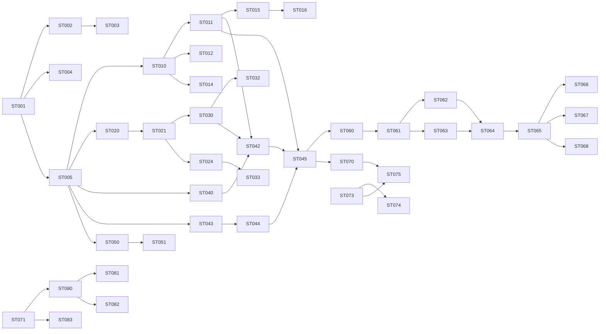

# DFCS User Stories and Backlog

Source of truth: `Drone_Flight_Control_System_SRS.md`. POC only; not certified or flight-ready (NFR-017).
Numeric values (gains, rates, thresholds, pin maps, timing/coverage) are TBD per OD-xxx; stories must not invent them.

## Conventions

- **Order:** host-testable portable core first (Waves 1-5), simulation next (Wave 6), target hardware last (Waves 7-8).
- **Size (S/M/L only):** S = one unit, few tests. M = one module with interfaces, several tests. L = cross-module/boundary work, split into sub-tasks (`.a`, `.b`, ...) that are each S or M and independently testable. Anything larger than L is split into separate stories.
- **Story format:** ID | title | size | priority | SRS refs | depends on | acceptance (tests as `TC-<AREA>-NNN`).
- Every story: tests cite the FR/NFR verified; RTM (SRS section 17) updated on completion; safety paths need fault-injection tests.
- Portable core must not include STM32 HAL or FreeRTOS headers (NFR-008). No dynamic allocation after init (NFR-005).
- Dependency notation: `->` means "needs"; `none` = can start immediately.

## Wave 1 - Host foundation and CI

| ID | Story | Size | Pri | Refs | Depends | Acceptance |
|---|---|---|---|---|---|---|
| ST-001 | **[DONE 2026-11-02]** As a developer, I can build the portable core and run GoogleTest on the desktop host with CMake+Ninja | M | P0 | FR-070, NFR-010 | none | `TC-CI-001`: clean checkout builds and runs a sample test using documented commands; tool versions pinned in a manifest |
| ST-002 | As a reviewer, PRs run host build + tests and fail on error | S | P0 | NFR-014 | ST-001 | `TC-CI-002`: deliberately failing test turns the pipeline red |
| ST-003 | As a maintainer, static analysis (Cppcheck, Clang-Tidy) runs in CI | M | P0 | NFR-012, NFR-014 | ST-002 | `TC-CI-003`: seeded critical finding blocks CI. Sub-tasks: ST-003.a propose formatter/coding standard/config (decision, no silent adoption); ST-003.b wire tools with pinned versions |
| ST-004 | As an architect, a check fails the build if core code includes HAL/FreeRTOS headers | S | P0 | NFR-008 | ST-001 | `TC-CI-004`: seeded forbidden include is detected |
| ST-005 | As a developer, I have common types: monotonic time interface, fault-code enum, result/status types, module-interface docs | M | P0 | FR-011, NFR-009, NFR-013 | ST-001 | `TC-SENS-001`: fake clock is monotonic; fault codes unique and printable |

## Wave 2 - State machine and safety gate (portable core)

| ID | Story | Size | Pri | Refs | Depends | Acceptance |
|---|---|---|---|---|---|---|
| ST-010 | Flight-state manager with states BOOT, INITIALIZING, DISARMED, ARMED, FAILSAFE, FAULT and explicit transition table | M | P0 | FR-030, FR-031 | ST-005 | `TC-STATE-001`: every legal transition accepted, every illegal one rejected (table-driven) |
| ST-011 | Actuator gate: outputs inhibited in BOOT, INITIALIZING, DISARMED, FAULT; safe output defined | M | P0 | FR-002, FR-046, FR-061 | ST-010 | `TC-SAFE-002`: output is safe value in each inhibited state, including from reset |
| ST-012 | Arm request rejected when any pre-arm check fails (pluggable check interface) | M | P0 | FR-032 | ST-010 | `TC-STATE-002`: each failing check blocks arming; rejection reason returned |
| ST-013 | Disarm request inhibits motor commands | S | P0 | FR-034 | ST-011 | `TC-STATE-003`: disarm from ARMED gates outputs immediately |
| ST-014 | Mode-command validation; only implemented+tested modes advertised | S | P0 | FR-033, FR-036 | ST-010 | `TC-STATE-004`: unsupported/invalid mode rejected, state unchanged; mode list equals implemented set |
| ST-015 | Failsafe handler with per-fault-class response table (classes and responses documented; values TBD) | M | P0 | FR-063, FR-066 | ST-010, ST-011 | `TC-SAFE-003`: fault injection per class drives defined response deterministically |
| ST-016 | Recovery requires explicit validated conditions; no automatic re-arm | S | P0 | FR-067 | ST-015, ST-012 | `TC-SAFE-004`: fault cleared does not re-arm; recovery path needs explicit command |
| ST-017 | State, mode, rejection/fault reasons exposed via diagnostic snapshot | S | P1 | FR-035, FR-004 | ST-012, ST-014 | `TC-STATE-005`: snapshot reflects state and last rejection reason |

## Wave 3 - Sensor interfaces and validation (portable core)

| ID | Story | Size | Pri | Refs | Depends | Acceptance |
|---|---|---|---|---|---|---|
| ST-020 | IMU interface (3-axis rate + accel), timestamped samples, fake IMU for tests | S | P0 | FR-010, FR-011 | ST-005 | `TC-SENS-002`: fake IMU samples carry monotonic timestamps |
| ST-021 | Sensor validation: freshness, range, plausibility (limits configurable, values TBD) | M | P0 | FR-012 | ST-020 | `TC-SENS-003`: stale, out-of-range, implausible samples flagged invalid (fault injection) |
| ST-022 | Sensor communication errors reported as diagnostic faults | S | P0 | FR-013 | ST-021 | `TC-SENS-004`: injected bus error yields fault code and invalid sample |
| ST-023 | Calibration parameters held in a config module separate from application logic | S | P1 | FR-017 | ST-005 | `TC-SENS-005`: params load/validate without touching logic code |
| ST-024 | Baro, GNSS, magnetometer interfaces + fakes. Sub-tasks: ST-024.a baro (S), ST-024.b GNSS (S), ST-024.c magnetometer, only if estimator needs it (S) | M | P1 | FR-014, FR-015, FR-016 | ST-021 | `TC-SENS-006`: each fake provides validated samples through its interface |
| ST-025 | Stale/lost mandatory control-input detection (RC/command input) | S | P0 | FR-062 | ST-005, ST-015 | `TC-SAFE-005`: input timeout raises fault and triggers failsafe |
| ST-026 | Battery threshold monitor logic (thresholds TBD, OD-014) | S | P1 | FR-065 | ST-015 | `TC-SAFE-006`: injected voltage below/above threshold raises/clears fault per config |

## Wave 4 - Estimation (portable core)

| ID | Story | Size | Pri | Refs | Depends | Acceptance |
|---|---|---|---|---|---|---|
| ST-030 | Estimator interface with validity/health output; invalid when mandatory input missing/stale/invalid | M | P0 | FR-021, FR-022 | ST-021 | `TC-EST-001`: each bad-input case marks output invalid (fault injection) |
| ST-031 | Estimator parameters externalised from control code | S | P1 | FR-023 | ST-030 | `TC-EST-002`: parameter change alters behaviour with no control-code change |
| ST-032 | Attitude estimator (roll/pitch/yaw), algorithm per OD-006. Sub-tasks: ST-032.a algorithm selection record (S, decision); ST-032.b implementation (M); ST-032.c replay tests with recorded/synthetic vectors (S) | L | P0 | FR-020 | ST-030, ST-031 | `TC-EST-003`: known rotation vectors yield expected attitude within tolerance (TBD) |
| ST-033 | Altitude estimate when baro enabled | M | P1 | FR-024 | ST-024.a, ST-030 | `TC-EST-004`: synthetic baro input yields altitude; disabled baro yields no altitude |

## Wave 5 - Control, mixer and host pipeline (portable core)

| ID | Story | Size | Pri | Refs | Depends | Acceptance |
|---|---|---|---|---|---|---|
| ST-040 | PID controller with output limits and anti-windup | M | P0 | FR-040, FR-042 | ST-005 | `TC-CTRL-001`: step response, saturation, anti-windup verified |
| ST-041 | Control config (gains, limits) validated and tagged with config version; values TBD (OD-007) | S | P1 | FR-047 | ST-040 | `TC-CTRL-002`: invalid config rejected; version reported |
| ST-042 | Controller accepts only valid estimates and valid commands; otherwise outputs inhibited/safe | S | P0 | FR-041, FR-046 | ST-040, ST-030, ST-011 | `TC-CTRL-003`: invalid estimate/command yields safe output (fault injection) |
| ST-043 | Quad-X mixer (roll, pitch, yaw, throttle -> 4 motors), signs/order in versioned config (OD-009) | M | P0 | FR-043, FR-045 | ST-005 | `TC-MIX-001`: each axis demand produces expected motor pattern; config documented |
| ST-044 | Mixer output bounded to configured actuator limits | S | P0 | FR-044 | ST-043 | `TC-MIX-002`: extreme demands never exceed limits |
| ST-045 | Host control pipeline: estimator -> PID -> mixer -> actuator gate, fixed-step, no dynamic allocation after init | M | P0 | FR-070, NFR-001, NFR-005 | ST-011, ST-042, ST-044 | `TC-CTRL-004`: end-to-end run on host with fake sensors; allocation hook reports zero post-init allocations |

## Wave 6 - Communication (portable core) and simulation

| ID | Story | Size | Pri | Refs | Depends | Acceptance |
|---|---|---|---|---|---|---|
| ST-050 | MAVLink 2 parser wrapper: allowlist of supported messages (subset per OD-010), validate length, source, parameters | M | P0 | FR-051 | ST-005 | `TC-COMM-001`: valid frames accepted; unsupported, bad-length, bad-source rejected |
| ST-051 | Command handler routes valid commands to state manager; unsupported commands rejected without touching actuator state | M | P0 | FR-054 | ST-050, ST-012, ST-014 | `TC-COMM-002`: rejected command leaves actuator gate state unchanged |
| ST-052 | Heartbeat and status telemetry (state, estimator, arming, sensor, fault) | S | P1 | FR-052, FR-053 | ST-050, ST-017 | `TC-COMM-003`: telemetry content matches diagnostic snapshot |
| ST-053 | Malformed/fuzzed input fails safely | S | P0 | NFR-016 | ST-050 | `TC-COMM-004`: fuzz corpus causes no crash, no state change |
| ST-054 | Bounded, non-blocking comm processing (fixed queue, bounded parse time per call) | S | P0 | FR-055, NFR-001 | ST-050 | `TC-COMM-005`: queue overflow drops data without blocking; parse step bounded |
| ST-055 | Evaluate MAVLink signing / authenticated commands (design review, no operational claim) | S | P1 | FR-056 | ST-050 | Review note recorded; decision filed |
| ST-060 | Simulation adapter interfaces: sensor provider and actuator sink implemented by fakes, same interfaces as hardware drivers | S | P0 | FR-071, FR-072 | ST-020, ST-045 | `TC-SIM-001`: core runs unchanged against fake adapter |
| ST-061 | Bridge specification: message types, units, frames, timestamps, rates, failure behaviour (OD-011) | S | P0 | FR-072 | ST-060 | Reviewed document in `simulation/bridge` |
| ST-062 | Frame and unit conversion library with tests | M | P0 | FR-071 | ST-061 | `TC-SIM-002`: conversions verified against known vectors |
| ST-063 | Gazebo Harmonic Quad-X model and world (parameters TBD) | M | P0 | FR-072 | ST-061 | `TC-SIM-003`: model loads; motors respond to commands |
| ST-064 | Gazebo bridge (L). Sub-tasks: ST-064.a transport (M); ST-064.b sensor publishing (M); ST-064.c actuator receive/apply (M); ST-064.d timestamp handling and failure behaviour (S) | L | P0 | FR-071, FR-072 | ST-062, ST-063, ST-060 | `TC-SIM-004`: core loop runs closed-loop against Gazebo; bridge loss handled per spec |
| ST-065 | Scenario runner recording configuration and seed | M | P1 | FR-073 | ST-064 | `TC-SIM-005`: same seed reproduces same result |
| ST-066 | pytest SITL: init and state transitions | S | P0 | FR-074 | ST-065, ST-010 | `TC-SIM-006` |
| ST-067 | pytest SITL: sensor fault injection | M | P0 | FR-074, FR-012 | ST-065, ST-021 | `TC-SIM-007` |
| ST-068 | pytest SITL: controller response and output limiting | M | P0 | FR-074, FR-040, FR-044 | ST-065, ST-045 | `TC-SIM-008` |
| ST-069 | SITL job in CI (nightly or on demand) | S | P1 | NFR-014, FR-074 | ST-066 | `TC-CI-005` |

## Wave 7 - Target design decisions and firmware skeleton

| ID | Story | Size | Pri | Refs | Depends | Acceptance |
|---|---|---|---|---|---|---|
| ST-070 | Task design: priorities, periods, deadlines, stacks, synchronization (values TBD, OD-005) | M | P0 | NFR-002, NFR-004, NFR-006 | ST-045 | Approved design doc incl. WCET analysis approach |
| ST-071 | Pin/peripheral map and board review (OD-002, OD-003) | S | P0 | NFR-009 | none | Reviewed map against board docs |
| ST-072 | DMA/cache policy: memory regions, alignment, cache maintenance (OD-004) | S | P0 | NFR-007 | ST-071 | Design review recorded |
| ST-073 | Arm GNU toolchain CMake preset builds firmware image with version/build metadata (no flashing in CI) | M | P0 | NFR-010, NFR-015 | ST-001 | `TC-CI-006`: reproducible ELF with embedded revision |
| ST-074 | Startup sequence and init-failure handling into safe state; init status via diagnostics | M | P0 | FR-001, FR-003, FR-004 | ST-010, ST-011, ST-073 | `TC-BOOT-001`: injected step failure ends in safe state, outputs inhibited (host test of sequencer) |
| ST-075 | RTOS task skeleton (FreeRTOS wrappers only in `firmware/rtos`), ownership rules for shared data | M | P0 | NFR-001, NFR-006, NFR-008 | ST-070, ST-073, ST-004 | Build passes boundary check; stress test plan defined |
| ST-076 | Execution-time and scheduling measurement hooks | S | P0 | NFR-003 | ST-075 | `TC-CI-007`: measured values reported |
| ST-077 | Watchdog supervision: portable task-health supervisor + IWDG/WWDG binding. Sub-tasks: ST-077.a supervisor logic on host (S); ST-077.b HAL binding (S) | M | P0 | FR-064 | ST-075, ST-015 | `TC-SAFE-007`: stalled task triggers fault/reset path |

## Wave 8 - Drivers and hardware (bench only: propulsion disabled, props removed, power isolated)

| ID | Story | Size | Pri | Refs | Depends | Acceptance |
|---|---|---|---|---|---|---|
| ST-080 | HAL: clocks/GPIO with actuator pins held in safe state from reset | M | P0 | FR-002, FR-061 | ST-071, ST-074 | `TC-BOOT-002` bench |
| ST-081 | IMU driver (device per OD-001) behind IMU interface, DMA per policy | M | P0 | FR-010, FR-013, NFR-007 | ST-020, ST-072, ST-080 | `TC-SENS-007` bench; bus error reports fault |
| ST-082 | Motor output driver (protocol per OD-008) honouring gate and mixer config | M | P0 | FR-045, FR-046 | ST-011, ST-043, ST-080 | `TC-MIX-003` bench with propulsion disabled |
| ST-083 | Independent hardware motor-disable path (OD-013) | M | P0 | FR-060 | ST-071 | `TC-SAFE-001` hardware inspection + bench; works with firmware halted |
| ST-084 | MAVLink UART transport (DMA) feeding the parser | M | P1 | FR-050 | ST-054, ST-072, ST-080 | `TC-COMM-006` loopback and GCS check (OD-010) |
| ST-085 | Baro, GNSS, magnetometer drivers (one sub-task each, S) | M | P1 | FR-014, FR-015, FR-016 | ST-024, ST-081 | `TC-SENS-008` |
| ST-086 | Battery ADC driver | S | P1 | FR-065 | ST-026, ST-080 | `TC-SAFE-008` bench |
| ST-087 | Bench verification checklist and control-loop timing acceptance (no flight) | M | P0 | NFR-003, NFR-004 | ST-076, ST-082, ST-083 | Checklist executed; results recorded |

## Wave 9 - Release and traceability (can start early, finish last)

| ID | Story | Size | Pri | Refs | Depends | Acceptance |
|---|---|---|---|---|---|---|
| ST-090 | RTM maintained and checked: each FR/NFR maps to design element and test | S | P0 | NFR-011 | ST-001 | `TC-CI-008`: unmapped P0 requirement is reported |
| ST-091 | Release pipeline: versioned artifacts with source revision and build metadata; never flashes or authorizes flight | M | P0 | NFR-015 | ST-073, ST-002 | `TC-CI-009` |
| ST-092 | Documentation states POC status, no certification or flightworthiness claim | S | P0 | NFR-017 | none | Documentation review |

## Dependency overview

## Parallelisation notes

- After ST-005: state machine (Wave 2), sensors (Wave 3), PID/mixer (Wave 5) and parser (ST-050) are independent tracks.
- ST-071, ST-092 and ST-090 have no code dependency and can start at any time.
- Open decisions (OD-001..OD-014) block only the stories that cite them; those stories deliver an interface plus TBD-marked config until the decision lands.
