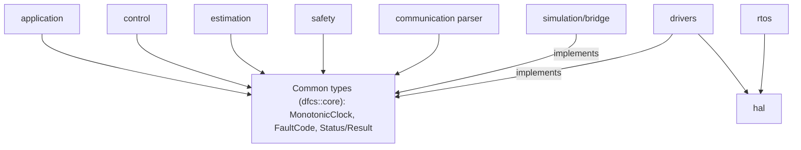

# DFCS Module Interfaces

Satisfies NFR-009 (documented interfaces, clear ownership of mutable data) for the `firmware/` modules and `simulation/bridge`. Source: SRS Appendix A, NFR-008, per-module `AGENTS.md` files and the ST-005 design (`docs/design/ST-005-common-types-and-module-interface-docs.md`).

POC only. Not certified, production-ready or flight-ready (NFR-017).

Maintenance: update this document with each module story. Interfaces whose story has no design yet are `TBD (<story or OD>)`. Nothing here fixes a numeric value (rates, periods, priorities, sizes, thresholds); those are open decisions (OD-xxx).

## 1. Module list

| Module | Layer | Responsibility |
|---|---|---|
| `firmware/application` | Portable core | Flight-state and mode manager; states BOOT, INITIALIZING, DISARMED, ARMED, FAILSAFE, FAULT (FR-030, FR-031) |
| `firmware/control` | Portable core | Attitude control (PID) and Quad-X mixer |
| `firmware/estimation` | Portable core | State estimation with validity and health per output (FR-021, FR-022) |
| `firmware/safety` | Portable core | Arming checks, output inhibition gate, failsafe, watchdog policy |
| `firmware/communication` | Portable core (parser, telemetry); platform (transport) | MAVLink 2 telemetry and command handling |
| `firmware/drivers` | Platform | Sensor and actuator drivers; implement the logical interfaces shared with the simulation adapter (FR-071) |
| `firmware/hal` | Platform | STM32CubeH7 HAL/LL wrappers; peripheral, DMA and cache handling |
| `firmware/rtos` | Platform | FreeRTOS task wiring and task-health reporting |
| `simulation/bridge` | Simulation | Gazebo bridge and simulation adapter (FR-071, FR-072) |

Not modules of this document:
- `firmware/navigation/` is intentionally absent: autonomous missions are out of scope (SRS 2.3).
- `simulation/gazebo` and `simulation/scenarios` hold simulator assets and scenario definitions; they expose no firmware interface. Their content is TBD (OD-011).
- `tests/` and `tools/` are not firmware modules.

## 2. Dependency rules

- The portable core (`application`, `control`, `estimation`, `safety`, communication parser) must not include STM32 HAL or FreeRTOS headers and must not expose them through its own headers (NFR-008).
- STM32CubeH7 HAL/LL is confined to `hal/` and `drivers/`; FreeRTOS headers only to `rtos/` and other platform code.
- Hardware drivers and the simulation adapter implement the same logical interfaces, so portable logic is unchanged between targets (FR-071).
- Allowed dependencies between portable modules (for example `control` on `estimation` output types, `application` on `safety`) are TBD until the owning stories define the interface headers. Cycles between portable modules are not allowed (ST-005 design, DD-1 revisit condition).
- No dynamic allocation after init and no blocking I/O in time-critical paths (NFR-001, NFR-005).

## 3. Common types

Location: `firmware/application/include/dfcs/`, namespace `dfcs::core`, built into the `dfcs_core` target (ST-005 DD-1). Headers include only `<cstddef>`, `<cstdint>` and each other.

| Header | Content | Usage convention |
|---|---|---|
| `monotonic_clock.hpp` | `TimestampUs` (`uint64_t` microseconds, arbitrary origin; resolution TBD, OD-005), comparison operators, `MonotonicClock::now()`, `elapsed_us(later, earlier)` | Timestamp samples with a `MonotonicClock` (FR-011). Use `elapsed_us` for ages: a backward pair returns `Status{InvalidArgument, TIME_NON_MONOTONIC}`, never zero or a wrapped value |
| `fault_code.hpp` | `FaultCode` (`uint16_t`; high byte category, low byte item; append-only; category `0xFF` reserved), `kFaultCodeCount`, `fault_code_table()`, `to_string(FaultCode)` | Report diagnosable conditions (NFR-013). The registry carries no severity or response: response per fault class is ST-015 (FR-066). Mapping to MAVLink or telemetry: TBD (OD-010) |
| `status.hpp` | `StatusCode`, `kStatusCodeCount`, `Status{code, fault}`, `Result<T>`, `to_string(StatusCode)` | Return operation outcomes; no exceptions, no heap, `[[nodiscard]]`. No default constructor, so an uninitialized outcome cannot read as success |

`FakeClock` (`tests/unit/fake_clock.hpp`, namespace `dfcs::test`) is a test double and is not part of the core.

### 3.1 Fault code registry (current)

| Category | Codes |
|---|---|
| `0x00` none | `NONE` |
| `0x01` init | `INIT_STEP_FAILED` |
| `0x02` time | `TIME_NON_MONOTONIC` |
| `0x03` sensor | `SENSOR_STALE`, `SENSOR_OUT_OF_RANGE`, `SENSOR_IMPLAUSIBLE`, `SENSOR_BUS_ERROR` |
| `0x04` estimation | `ESTIMATOR_INPUT_INVALID` |
| `0x05` control input | `CONTROL_INPUT_LOST` |
| `0x06` communication | `COMM_MALFORMED_MESSAGE`, `COMM_UNSUPPORTED_COMMAND` |
| `0x07` safety/platform | `WATCHDOG_TASK_HEALTH`, `BATTERY_THRESHOLD` (threshold TBD, OD-014) |

The initial set is proposed by ST-005; owner stories may refine a code before its first use. Numeric values are defined in `fault_code.hpp`, which is authoritative.

### 3.2 Status codes (current)

`Ok`, `InvalidArgument`, `OutOfRange`, `NotReady`, `Timeout`, `Unsupported`, `Rejected`, `DeviceError`, `Internal`.
- `Rejected` and `Unsupported` mean the request was refused with no effect on actuator state (FR-032, FR-033, FR-054).
- `StatusCode` describes an operation outcome; `FaultCode` describes a diagnosable system condition. A `Status` may carry both.

## 4. Interface conventions

- Value types: common types are trivially copyable value types. Data crosses module boundaries by copy or const reference; the owner is the only writer (NFR-009).
- Errors: functions that can fail return `Status` or `Result<T>`. Callers do not drop them (`[[nodiscard]]`).
- Time: every sensor sample carries a `TimestampUs` from a `MonotonicClock` (FR-011). `MonotonicClock` implementations are non-decreasing, never wall-clock, non-blocking, bounded, and perform no allocation or I/O. Origins are not comparable across restarts or simulator resets. Equal consecutive readings are valid.
- Time contexts: which task or ISR may call `now()`, and 64-bit read atomicity on the 32-bit target, are documented per adapter. TBD (NFR-002, NFR-006).
- Printing: `to_string` for `FaultCode` and `StatusCode` never returns null; an unregistered value returns `"UNKNOWN"`.
- Validation: externally supplied values are validated at the boundary; malformed input fails safely (NFR-016).
- Safe default: unknown, invalid or uninitialized state resolves to inhibited actuator outputs. Outputs stay inhibited in BOOT, INITIALIZING, DISARMED and FAULT; there is no automatic re-arm.
- Interface names and signatures for modules other than the common types are TBD until their stories are designed; this document records only the decided responsibilities.

## 5. Module sections

### firmware/application

| Field | Content |
|---|---|
| Layer | Portable core |
| Provides | Flight-state and mode manager: explicit transition table; arming rejection with reason; rejection of unsupported or invalid mode commands; only implemented and tested modes exposed (FR-030 to FR-036). Interface names: TBD (ST-010) |
| Requires | Common types; safety manager pre-arm and failsafe results (interface TBD, ST-012, ST-015); estimation validity (TBD) |
| Owned mutable data | Current flight state and transition handling. Single writer: this module. Others receive copies |
| Allowed includes | Common types and other portable modules only (dependencies TBD); no STM32 HAL, no FreeRTOS (NFR-008) |
| Concurrency | TBD (NFR-002, NFR-006) until RTOS design |
| Open decisions | None specific. OD-012 for any numeric timing targets |

### firmware/control

| Field | Content |
|---|---|
| Layer | Portable core |
| Provides | PID attitude control with output limits and anti-windup; Quad-X mixer bounded to configured actuator limits (FR-042, FR-044). Interface names: TBD (ST-040, ST-043) |
| Requires | Common types; validated state estimate and valid command input only (FR-041); versioned configuration (FR-045, FR-047) |
| Owned mutable data | Controller internal state (integrators and similar). Single writer: this module. Gains, limits, motor order, rotation direction and mixer signs are versioned configuration, not module state |
| Allowed includes | Common types; estimation output types (TBD); no STM32 HAL, no FreeRTOS (NFR-008) |
| Concurrency | TBD (NFR-002, NFR-006) |
| Open decisions | OD-007 (gains, limits, anti-windup), OD-009 (motor numbering and rotation), OD-005 (loop periods) |

### firmware/estimation

| Field | Content |
|---|---|
| Layer | Portable core |
| Provides | Attitude and state estimate; every output carries validity and health (FR-021). Missing, stale or invalid mandatory input marks the output invalid (FR-022). Interface names: TBD (ST-030) |
| Requires | Common types; validated, monotonic-timestamped samples (FR-011, FR-012); configuration parameters (FR-023) |
| Owned mutable data | Estimator internal state and the current estimate. Single writer: this module. Consumers receive copies |
| Allowed includes | Common types; sensor sample types (TBD, ST-020); no STM32 HAL, no FreeRTOS (NFR-008) |
| Concurrency | TBD (NFR-002, NFR-006) |
| Open decisions | OD-006 (algorithm), OD-005 (rates) |

### firmware/safety

| Field | Content |
|---|---|
| Layer | Portable core |
| Provides | Arming checks, output inhibition gate independent of the control calculation (FR-046), failsafe, watchdog policy (FR-064). One deterministic documented response per fault class (FR-066): TBD (ST-015). Recovery from FAILSAFE or FAULT needs explicit validated conditions; no auto re-arm (FR-067). Interface names: TBD |
| Requires | Common types; interfaces to the hardware motor-disable path and the watchdog (TBD, OD-013); task-health reports from `rtos` (FR-064) |
| Owned mutable data | Watchdog policy state, failsafe state, output-inhibit decision. Single writer: this module. The failsafe actuator response is TBD pending safety analysis |
| Allowed includes | Common types; no STM32 HAL, no FreeRTOS (NFR-008). Hardware reached only through interfaces |
| Concurrency | TBD (NFR-002, NFR-006) |
| Open decisions | OD-013 (hardware-disable implementation), OD-014 (battery thresholds), OD-012 |

### firmware/communication

| Field | Content |
|---|---|
| Layer | Portable core (allowlist parser, telemetry); platform (transport, TBD) |
| Provides | MAVLink 2 parsing of supported messages with length, source and parameter validation (FR-051); bounded buffers; unsupported commands rejected without touching actuator state (FR-054); telemetry. Parsing must not block time-critical control (FR-055). Supported message subset TBD (OD-010) |
| Requires | Common types; flight state and fault status for telemetry (TBD) |
| Owned mutable data | Parser and receive-buffer state. Single writer: this module. Command results reach other modules as validated values, not raw messages |
| Allowed includes | Common types for the parser; transport code may use platform headers and stays outside the portable parser (NFR-008) |
| Concurrency | TBD (NFR-002, NFR-006) |
| Open decisions | OD-010 (message subset, GCS compatibility). Signing or authenticated channel to be evaluated before radio deployment (FR-056). QGroundControl is not claimed compatible until an interoperability test passes |

### firmware/drivers

| Field | Content |
|---|---|
| Layer | Platform |
| Provides | Hardware implementations of the sensor and actuator interfaces shared with the simulation adapter (FR-071); samples timestamped from a monotonic source (FR-011); bus and device errors reported as diagnostic faults (FR-013); a `MonotonicClock` adapter (TBD) |
| Requires | `hal`; common types |
| Owned mutable data | Per-device driver state and raw buffers. Single writer: the driver. Actuator outputs are inhibited from reset until the safety gate enables them (FR-002) |
| Allowed includes | STM32 HAL/LL via `hal` (confined to `hal/` and `drivers/`); common types. Must not leak HAL types into headers consumed by the portable core (NFR-008) |
| Concurrency | TBD (NFR-002, NFR-006); DMA and cache rules per OD-004 |
| Open decisions | OD-001 (parts), OD-003 (peripheral allocation), OD-005 (sample rates), OD-008 (ESC protocol) |

### firmware/hal

| Field | Content |
|---|---|
| Layer | Platform |
| Provides | Peripheral wrappers over STM32CubeH7 HAL/LL. No HAL types exposed to the portable core |
| Requires | STM32CubeH7 HAL/LL |
| Owned mutable data | Peripheral handles, DMA buffers. Memory placement, alignment and D-cache maintenance are documented explicitly (NFR-007). Placement TBD (OD-004) |
| Allowed includes | STM32CubeH7 HAL/LL. No dependency on the portable core beyond common types |
| Concurrency | Cross-task and ISR rules TBD (NFR-002, NFR-006) |
| Open decisions | OD-002 (board revision), OD-003 (peripheral allocation), OD-004 (DMA and cache policy) |

### firmware/rtos

| Field | Content |
|---|---|
| Layer | Platform |
| Provides | FreeRTOS task wiring; task-health reporting wired to the watchdog policy owned by `safety` (FR-064); critical-task execution-time measurement (NFR-003) |
| Requires | `safety` task-health and watchdog interface (TBD); `hal`; common types |
| Owned mutable data | RTOS objects (tasks, queues, mutexes), created at init only; no allocation afterwards (NFR-005). Synchronization and ownership of data shared between tasks and interrupts documented here as it is defined (NFR-006) |
| Allowed includes | FreeRTOS headers (only platform code includes them); common types |
| Concurrency | Task priorities, periods, deadlines and stack sizes: TBD (NFR-002, OD-005) |
| Open decisions | OD-005, OD-012 |

### simulation/bridge

| Field | Content |
|---|---|
| Layer | Simulation |
| Provides | Same logical sensor interfaces as the hardware drivers (FR-071); actuator commands applied to the simulated vehicle through a documented bridge (FR-072); a `MonotonicClock` implementation that stays monotonic across simulator resets (TBD). Message types, units, coordinate frames, timestamps, update rates and failure behavior documented per SRS 9.4; frame and unit conversions tested. Lost or late simulator data surfaces as stale-sensor faults, never silent defaults |
| Requires | Common types; Gazebo transport (TBD, OD-011) |
| Owned mutable data | Bridge buffers and simulator-side state mirrors. Single writer: the bridge. Layout TBD (OD-011) |
| Allowed includes | Common types and the shared sensor and actuator interfaces; simulator libraries stay in the bridge. No STM32 HAL, no FreeRTOS |
| Concurrency | TBD |
| Open decisions | OD-011 (bridge implementation: transport, frames, units, timestamps, adapter) |

## 6. Open items

| Item | Status |
|---|---|
| Interface names and signatures per module | TBD, filled by each module story |
| Allowed dependencies between portable modules | TBD until interface headers exist |
| Task and ISR access, synchronization, ownership of shared data | TBD (NFR-002, NFR-006) |
| Clock resolution and update rate | TBD (OD-005) |
| Numeric timing, memory and coverage targets | TBD (OD-012) |
| Fault code to MAVLink or telemetry mapping | TBD (OD-010) |
| Failsafe response per fault class | TBD (ST-015) |

Traceability: NFR-009 evidence is this document plus review; the completeness check is `TC-CI-010` (ST-005 T6).
