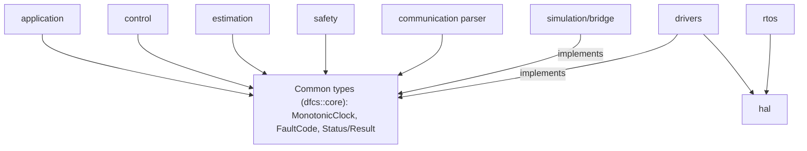

# ST-005 - Common types and module-interface docs

## 1. Header

| Field | Value |
|---|---|
| Story ID | ST-005 |
| Title | Common types: monotonic time interface, fault-code enum, result/status types, module-interface docs |
| Size | M |
| Priority | P0 |
| Status | Draft |
| Dependencies | ST-001 (done) |
| Dependents | ST-010, ST-020, ST-023, ST-025, ST-040, ST-043, ST-050 |
| Date | 2026-11-03 |

POC only; not certified, production-ready or flight-ready (NFR-017).

## 2. Story summary

Provide the shared, portable vocabulary every other module builds on: a monotonic time interface with a fake for tests, a stable printable fault-code registry, and a result/status type, plus a document that states each module's interfaces and data ownership.

## 3. Requirements analysis

### 3.1 Requirements cited by the story

| ID | SRS summary | Interpretation | Ambiguity |
|---|---|---|---|
| FR-011 | Timestamp sensor samples using a monotonic time source (P0, unit test) | ST-005 delivers the time source interface and a fake. The sample struct that carries a timestamp is ST-020. "Monotonic" is defined here as non-decreasing: two reads may return equal values, a read never returns less than an earlier read. | Time unit, width and resolution are not specified. Resolution depends on sample rates (TBD, OD-005). |
| NFR-009 | Modules have documented interfaces and clear ownership of mutable data (P0, review) | A module-interface document covering every `firmware/` module and the simulation bridge: provided and required interfaces, single owner of each mutable datum, allowed dependencies. Common types are value types so ownership transfers by copy. | Document location and format are not specified. SRS Appendix A suggests `docs/architecture/`. Interface names for modules whose stories do not exist yet are unknown. |
| NFR-013 | Diagnosable fault codes and useful logs without compromising time-critical execution (P1, integration) | ST-005 delivers the fault-code registry and printing (`to_string`). It does not deliver a log sink, telemetry mapping or diagnostics interface. The story is P0 while the SRS requirement is P1; this is a foundation choice, not a conflict. | Initial fault-code set is not specified; the SRS names fault classes only implicitly (FR-003, FR-012, FR-013, FR-022, FR-051, FR-054, FR-062, FR-064, FR-065). |

Cited open decisions: the story cites none. OD-005 and OD-010 are touched indirectly and stay TBD (section 9).

### 3.2 Related requirements (constraints and consumers)

| ID | Why it matters here |
|---|---|
| NFR-008, NFR-005, NFR-001 | Types must be usable by the portable core: no HAL/FreeRTOS, no heap, no I/O. See section 6. |
| FR-071 | Hardware drivers and the simulation adapter must implement the same clock interface. |
| FR-012 | Stale-data detection needs a safe time-difference operation (backward time must not look fresh). |
| NFR-006, NFR-002 | Cross-task and ISR use of the clock is documented as a contract; mechanisms are TBD. |
| NFR-011 | RTM rows are added (section 8). |
| FR-066, FR-063 | Per-fault-class response is NOT defined here (ST-015). |
| OD-005, OD-010 | Clock resolution and fault-code-to-MAVLink mapping are TBD. |

### 3.3 Test-ID conflict between story and SRS (resolved by user decision)

- SRS 11.3 and the SRS section 17 FR-012 row own `TC-SENS-001` (stale IMU sample rejected). The SRS is not edited.
- Story row ST-005 in `docs/DFCS_Stories.md` lists `TC-SENS-001` for "fake clock is monotonic; fault codes unique and printable". That clashes with the SRS.
- Decision (user): ST-005 does not use `TC-SENS-001`. Its acceptance test is `TC-SENS-011`, the next free `TC-SENS` ID. Used IDs checked: `TC-SENS-001` (SRS 11.3, section 17), `TC-SENS-002` to `TC-SENS-008` (stories ST-020 to ST-085), `TC-SENS-009` and `TC-SENS-010` (this design). No `TC-SENS-011` or higher exists in the SRS, the stories file or other designs.
- Follow-up for the user/maintainer (not done here): the ST-005 row in `docs/DFCS_Stories.md` still lists `TC-SENS-001` and must be reconciled to `TC-SENS-011`. Until then the story file and this design disagree on the ID; this design is authoritative for ST-005 evidence. This analysis does not edit that file.
- The same pattern exists for `TC-CI-001` (SRS 11.3: pipeline blocks artifact release; ST-001: host build). It belongs to ST-001/ST-002 and is not addressed here.

## 4. Scope

In scope:
- `MonotonicClock` interface, `TimestampUs`, safe elapsed-time helper, `FakeClock` for host tests.
- `FaultCode` registry with printable names.
- `StatusCode`, `Status`, `Result<T>`.
- Module-interface document and a completeness check.

Out of scope:
- Any edit to the SRS or to `docs/DFCS_Stories.md` (the story-row ID follow-up in 3.3 is for the user/maintainer).
- Sample structs and IMU interface (ST-020), validation (ST-021), per-fault response table (ST-015), state machine (ST-010), log sink, telemetry or MAVLink mapping (OD-010), real hardware or Gazebo clock adapters (HAL/drivers/bridge stories), RTOS task design.
- Source or test code in this analysis; implementation follows section 11.

Interpretation notes:
- Equal consecutive timestamps are valid (resolution can be coarser than call rate).
- `TC-SENS-011` covers both the clock and fault-code checks (two groups of GoogleTest cases under one ID); see 3.3 for why it is not `TC-SENS-001`.

Assumptions:
- The portable core remains in the existing `dfcs_core` target (`firmware/application`), namespace `dfcs::core`. SRS Appendix A has no common module folder, so none is added (DD-1, decided).
- Exceptions and RTTI are not used (target compile flags undecided).
- C++17 only; no `std::expected`.

## 5. Design

### 5.1 Module and files (proposed)

| Path | Content |
|---|---|
| `firmware/application/include/dfcs/fault_code.hpp`, `src/fault_code.cpp` | `FaultCode`, `kFaultCodeCount`, `FaultCodeEntry`, `FaultCodeTable`, `fault_code_table()`, `to_string(FaultCode)` |
| `firmware/application/include/dfcs/status.hpp`, `src/status.cpp` | `StatusCode`, `kStatusCodeCount`, `Status`, `Result<T>`, `to_string(StatusCode)` |
| `firmware/application/include/dfcs/monotonic_clock.hpp` | `TimestampUs` (with comparison operators), `MonotonicClock`, `elapsed_us()` |
| `tests/unit/fake_clock.hpp` | `FakeClock` (test double, not shipped in the core), namespace `dfcs::test` |
| `docs/architecture/module-interfaces.md` | Module-interface document |
| `tests/automation/test_module_interfaces_doc.py` | Document completeness check |

`firmware/application/src/core_info.cpp` stays until the user decides to retire the TC-CI-001 placeholder; only its comment about ST-005 is updated.

### 5.2 Monotonic time

```cpp
struct TimestampUs { std::uint64_t value; };   // microseconds since an arbitrary origin
// constexpr noexcept ==, !=, <, <=, >, >= compare `value` only.

class MonotonicClock {
 public:
  virtual TimestampUs now() const noexcept = 0;
 protected:
  ~MonotonicClock() = default;                 // non-virtual: no delete through base
};

Result<std::uint64_t> elapsed_us(TimestampUs later, TimestampUs earlier) noexcept;
```

Contract for every implementation (hardware, Gazebo bridge, fake):
- Non-decreasing across successive calls; never wall-clock; origin arbitrary and not comparable across restarts or simulator resets.
- `now()` is non-blocking, bounded, performs no allocation and no I/O.
- 64-bit microseconds does not wrap in practice; wrap handling is not implemented.
- Calling contexts (task, ISR) and 64-bit read atomicity on the 32-bit target are documented per adapter (NFR-006, TBD).
- Resolution and update rate: TBD (OD-005).

`elapsed_us(later, earlier)`:
- `later >= earlier` returns the difference.
- `later < earlier` returns an error `Status{InvalidArgument, FaultCode::TIME_NON_MONOTONIC}`; it never returns 0 or a wrapped value, so a backward clock cannot make old data look fresh (consumed by ST-021).

`elapsed_us` takes two `TimestampUs` values, not a clock. It is a pure function of its arguments and has no clock dependency. No unit in ST-005 consumes a `MonotonicClock` other than `FakeClock` implementing it, so no stub-clock or injection seam is needed in ST-005. The first consumer of a clock is ST-021 (stale-data check); clock-injection tests belong to that story.

`FakeClock` (test only, `tests/unit/fake_clock.hpp`, namespace `dfcs::test`):

```cpp
class FakeClock final : public MonotonicClock {
 public:
  explicit constexpr FakeClock(TimestampUs start = TimestampUs{0}) noexcept;
  TimestampUs now() const noexcept override;           // returns current value, no side effect
  Status advance(std::uint64_t delta_us) noexcept;
  Status set(TimestampUs t) noexcept;
};
```

| Operation | Condition | Resulting time | Returned `Status` |
|---|---|---|---|
| `advance(d)` | `d <= max - current` (includes `d == 0` and landing exactly on max) | `current + d` | `Status::ok()` |
| `advance(d)` | `d > max - current` (would overflow; includes any `d > 0` at max) | saturates at `max` (`UINT64_MAX`) | `Status::error(StatusCode::OutOfRange)`, fault `NONE` |
| `set(t)` | `t >= current` (equal time is accepted, time unchanged in value) | `t` | `Status::ok()` |
| `set(t)` | `t < current` | unchanged | `Status::error(StatusCode::InvalidArgument, FaultCode::TIME_NON_MONOTONIC)` |

- Return type is `Status` (`[[nodiscard]]` via the type, 5.4); tests assert `is_ok()`, `code` and `fault`.
- Overflow on `advance` is test-double misuse, not a system fault, so its fault code is `NONE`. A backward `set` uses the same pair as `elapsed_us` backward time.
- `now()` between operations never decreases, including after a rejected `set` or a saturated `advance`.

### 5.3 Fault codes

```cpp
enum class FaultCode : std::uint16_t { NONE = 0, /* see table */ };
const char* to_string(FaultCode) noexcept;     // never null; unknown value -> "UNKNOWN"

inline constexpr std::size_t kFaultCodeCount = 13;   // enumerators incl. NONE; edited with the enum
struct FaultCodeEntry { FaultCode code; const char* name; };
struct FaultCodeTable { const FaultCodeEntry* entries; std::size_t size; };
FaultCodeTable fault_code_table() noexcept;    // the table `to_string` searches; read-only, static storage
```

Rules:
- Explicit numeric values; high byte is the category, low byte the item. Category `0xFF` is reserved and never allocated, so `static_cast<FaultCode>(0xFFFF)` is guaranteed unknown.
- Append-only: a published value is never reused or renumbered. Names are upper-case ASCII with underscores.
- Table-driven: one `constexpr` table of `{code, name}`; `to_string` does a bounded linear search over `fault_code_table()`; no `std::string`, no formatting, no I/O.
- Completeness seam (DD-5): `kFaultCodeCount` is the enumerator count, declared next to the enum. A test checks `fault_code_table().size == kFaultCodeCount`, that each entry has a unique code and name, and that `to_string(entry.code)` returns `entry.name`. A new enumerator requires the enum, `kFaultCodeCount` and the table to change together. C++17 has no enum reflection and no sentinel is added to the enum (codes are sparse and a sentinel would be a valid-looking value); an enumerator added without changing the count is not detectable by test and is covered by review.
- The registry carries no severity and no response. Response per class is ST-015 (FR-066).
- Mapping to MAVLink or telemetry fields: TBD (OD-010).

Initial set (proposed; owner story may refine before first use):

| Value | Name | Source requirement | Owner story |
|---|---|---|---|
| 0x0000 | `NONE` | n/a | ST-005 |
| 0x0101 | `INIT_STEP_FAILED` | FR-003 | ST-074 |
| 0x0201 | `TIME_NON_MONOTONIC` | FR-011 | ST-005 |
| 0x0301 | `SENSOR_STALE` | FR-012 | ST-021 |
| 0x0302 | `SENSOR_OUT_OF_RANGE` | FR-012 | ST-021 |
| 0x0303 | `SENSOR_IMPLAUSIBLE` | FR-012 | ST-021 |
| 0x0304 | `SENSOR_BUS_ERROR` | FR-013 | ST-022 |
| 0x0401 | `ESTIMATOR_INPUT_INVALID` | FR-022 | ST-030 |
| 0x0501 | `CONTROL_INPUT_LOST` | FR-062 | ST-025 |
| 0x0601 | `COMM_MALFORMED_MESSAGE` | FR-051, NFR-016 | ST-050 |
| 0x0602 | `COMM_UNSUPPORTED_COMMAND` | FR-054 | ST-051 |
| 0x0701 | `WATCHDOG_TASK_HEALTH` | FR-064 | ST-077 |
| 0x0702 | `BATTERY_THRESHOLD` | FR-065 (thresholds TBD, OD-014) | ST-026 |

Categories: 0x01 init, 0x02 time, 0x03 sensor, 0x04 estimation, 0x05 control input, 0x06 communication, 0x07 safety/platform.

### 5.4 Result and status types

```cpp
enum class StatusCode : std::uint8_t {
  Ok, InvalidArgument, OutOfRange, NotReady, Timeout, Unsupported, Rejected, DeviceError, Internal };

struct [[nodiscard]] Status {
  StatusCode code; FaultCode fault;            // fault is NONE unless a diagnosable fault applies
  static constexpr Status ok() noexcept;
  static constexpr Status error(StatusCode, FaultCode = FaultCode::NONE) noexcept;
  constexpr bool is_ok() const noexcept;
};

template <class T> class [[nodiscard]] Result {   // T: trivially copyable, default-constructible
 public:
  static constexpr Result success(T) noexcept;
  static constexpr Result failure(Status) noexcept;   // failure(Ok) is coerced to Internal
  constexpr bool is_ok() const noexcept;
  constexpr Status status() const noexcept;
  constexpr T value_or(T fallback) const noexcept;
  constexpr const T& value() const noexcept;      // precondition: is_ok()
};
const char* to_string(StatusCode) noexcept;      // unknown value -> "UNKNOWN"
inline constexpr std::size_t kStatusCodeCount = 9;   // contiguous 0..kStatusCodeCount-1; Internal stays last
```

Rules:
- `StatusCode` values are contiguous from 0, so no table accessor is needed: a test iterates `0..kStatusCodeCount-1`, checks each `to_string` is unique, non-empty, printable and not `"UNKNOWN"`, and that `kStatusCodeCount` itself prints `"UNKNOWN"`. A new enumerator is appended before the count is raised (DD-5).
- No default constructor for `Status` or `Result`: an uninitialized outcome cannot silently read as success.
- `Rejected` and `Unsupported` mean the request was refused with no side effect on actuator state (FR-032, FR-033, FR-054). Detailed rejection reasons (FR-035) belong to ST-012 and ST-050.
- `StatusCode` describes an operation outcome; `FaultCode` describes a diagnosable system condition. They stay separate; a function may return both through `Status`.
- No exceptions, no heap, `noexcept` throughout, `[[nodiscard]]` so errors are not dropped.

### 5.5 Module-interface document

`docs/architecture/module-interfaces.md` has one section per module with fixed fields:

| Field | Meaning |
|---|---|
| Layer | Portable core, platform (HAL/drivers/RTOS), or simulation |
| Provides | Interfaces exposed, with owner story; `TBD (<story>)` where not yet designed |
| Requires | Interfaces consumed |
| Owned mutable data | Data this module is the single writer of; all others receive const references or copies |
| Allowed includes | Common types only for portable modules; no HAL or FreeRTOS (NFR-008) |
| Concurrency | Task/ISR access and synchronization, `TBD (NFR-002, NFR-006)` until RTOS design |
| Open decisions | OD references |

Initial content is drawn from the module `AGENTS.md` files:

| Module | Layer | Known provides / requires | Open decisions |
|---|---|---|---|
| `firmware/application` | Portable | Flight-state manager, mode handling; requires safety, common types | none specific |
| `firmware/control` | Portable | PID, mixer; requires validated estimate, config | OD-007, OD-009 |
| `firmware/estimation` | Portable | Estimator with validity/health; requires validated samples | OD-006 |
| `firmware/safety` | Portable | Output gate, failsafe, watchdog policy; requires motor-disable and watchdog interfaces | OD-013 |
| `firmware/communication` | Portable parser, platform transport | Allowlist parser, telemetry; requires state and fault status | OD-010 |
| `firmware/drivers` | Platform | Implements sensor and actuator interfaces | OD-001, OD-003, OD-005, OD-008 |
| `firmware/hal` | Platform | Peripheral wrappers; no HAL types exposed to the core | OD-002, OD-003, OD-004 |
| `firmware/rtos` | Platform | Task wiring, task-health reporting | OD-005, NFR-002 |
| `simulation/bridge` | Simulation | Same logical interfaces as drivers, Gazebo transport | OD-011 |

`firmware/navigation/` is intentionally absent (SRS 2.3) and is not documented as a module.

### 5.6 Dependency diagram



### 5.7 Safety behavior

ST-005 contains no actuator path and cannot change actuator state. Fail-safe properties of the types:
- Backward time returns an error, never zero age (supports FR-012, FR-022 consumers).
- Unknown enum values print as `UNKNOWN` rather than a null pointer or crash.
- No default-constructed success.
- Time-source faults surface as `TIME_NON_MONOTONIC`; the response is decided by ST-015.

## 6. Architecture constraints check

| Requirement | Compliance rationale | Verifying TC IDs |
|---|---|---|
| NFR-008 | Headers include only `<cstdint>`, `<cstddef>`, `<type_traits>`. No STM32 or FreeRTOS types. Clock adapters for hardware live in `hal`/`drivers`/`rtos`; ST-004 (`TC-CI-004`) enforces the include ban in CI. | `TC-CI-004` (ST-004), `TC-SENS-010` (`static_assert` on value types) |
| NFR-005 | All types are value types with static storage. `to_string` returns string literals. No `new`, `std::string`, `std::vector`, `std::function`. `FakeClock` is a test-only object. | `TC-SENS-010` (trivially copyable, no heap use by construction); review |
| NFR-001 | `now()` contract is non-blocking and bounded. `to_string` is a bounded search of a small constant table. No printf, console, file or network access. Virtual dispatch on `now()` is bounded; cost to be measured under NFR-003. | Structural only (`noexcept` `static_assert`, no I/O by construction): `TC-SENS-011` (`to_string(FaultCode)`, `fault_code_table()`, `FakeClock`), `TC-SENS-009` (`elapsed_us`), `TC-SENS-010` (`Status`, `Result`, `to_string(StatusCode)`); timing measured later (`TC-CI-007`, ST-076) |

## 7. Test design

| Test ID | Framework | FR/NFR verified | Fault injection | Cases |
|---|---|---|---|---|
| `TC-SENS-011` (ST-005 acceptance; story row lists `TC-SENS-001`, see 3.3) | GoogleTest | FR-011, NFR-013, NFR-001 (structural) | Yes | (a) `FakeClock` (5.2): non-decreasing over repeated `advance`; equal reads allowed; `advance` returns `Status::ok()` on success; `set` to an equal time returns ok; `set` to an earlier time returns `Status{InvalidArgument, TIME_NON_MONOTONIC}` and time is unchanged; (b) every `FaultCode` has a unique value and a unique, non-empty, printable-ASCII name; completeness via the seam (5.3): `fault_code_table().size == kFaultCodeCount`, `to_string(entry.code) == entry.name` for each entry, and each 5.3 enumerator is present in the table; `NONE == 0`; `static_assert` `noexcept` on `to_string(FaultCode)`, `fault_code_table()` and `FakeClock` members |
| `TC-SENS-009` (new) | GoogleTest | FR-011, NFR-001 (structural) | Yes | `elapsed_us` takes timestamps only (5.2): equal gives 0; later gives difference; later < earlier returns `TIME_NON_MONOTONIC` (not 0, not wrapped); maximum-value boundary; `FakeClock::advance` overflow returns `Status{OutOfRange, NONE}` and saturates at max; `advance` landing exactly on max returns ok; no case uses a clock stub |
| `TC-SENS-010` (new) | GoogleTest | NFR-013, NFR-001 (structural) | Yes | `Status`/`Result`: factories, `value_or` on failure, `failure(Ok)` coerced to `Internal`; `to_string(StatusCode)` unique and printable for `0..kStatusCodeCount-1`; out-of-range value gives `"UNKNOWN"` for `StatusCode` (`kStatusCodeCount`) and `FaultCode` (`0xFFFF`, reserved category, also absent from the table); `static_assert` trivially copyable and `noexcept` |
| `TC-CI-010` (new) | pytest | NFR-009 | No (seeded negative case) | Interface doc has a section for each `firmware/*` module folder and `simulation/bridge`, each with all required fields non-empty; seeded missing section is detected |

FR-071 is supported (the interface is shared by adapters) but not verified in ST-005; it is verified when the hardware and simulation adapters exist, so no ST-005 test cites it. NFR-009 unit-level evidence is by-copy value types only (supporting, not a verification); its verification is `TC-CI-010` plus review, so `TC-SENS-010` does not cite it.

Next-free IDs: highest used are `TC-SENS-010` (this design) and `TC-CI-009`. `TC-SENS-001` is reserved for SRS 11.3 (FR-012, stale IMU sample rejected) and is not used by ST-005.

Safety-path coverage: ST-005 adds no inhibit, failsafe, stale-sensor or malformed-message path. Fault-injection cases cover its own failure modes: backward clock, out-of-range enum values, failed results. Stale-sensor and malformed-input injection remain with ST-021, ST-050 and later stories.

## 8. RTM entries (SRS section 17)

| Requirement ID | Requirement summary | Design component | Test case ID | Status | Evidence |
|---|---|---|---|---|---|
| FR-011 | Timestamp samples with monotonic time source | `MonotonicClock`, `TimestampUs`, `elapsed_us`, `FakeClock` (ST-005); sample timestamps complete in ST-020 | TC-SENS-011, TC-SENS-009 (+ TC-SENS-002 in ST-020) | Planned | Pending |
| NFR-009 | Documented module interfaces and data ownership | `docs/architecture/module-interfaces.md` | TC-CI-010 (+ review) | Planned | Pending |
| NFR-013 | Diagnosable fault codes | `FaultCode` registry, `Status`/`Result` | TC-SENS-011, TC-SENS-010 | Planned | Pending |

The FR-012 row and SRS 11.3 keep `TC-SENS-001`; no change is made to them.

## 9. Open decisions

| Item | Status |
|---|---|
| `TC-SENS-001` ID conflict (3.3) | Decided: ST-005 uses `TC-SENS-011`; SRS untouched. Non-blocking follow-up for the user/maintainer: reconcile the ST-005 row in `docs/DFCS_Stories.md` |
| Clock resolution and update rate | TBD (OD-005). Placeholder: `TimestampUs` is microseconds (DD-2); no resolution is promised, equal consecutive reads are valid |
| Numeric timing, memory, coverage targets (e.g. `now()` execution-time budget) | TBD (OD-012). Placeholder: no numeric target in ST-005 tests; bounded behavior is checked structurally only |
| Battery threshold behind `BATTERY_THRESHOLD` | TBD (OD-014). Placeholder: the code is registered with no threshold value; ST-026 supplies it |
| Fault code to MAVLink/telemetry mapping | TBD (OD-010). Deferred: the registry holds no wire value; mapping is added by the communication stories |
| Failsafe response per fault class | TBD (ST-015). Deferred: the registry carries no severity or response; no ST-005 task depends on it |
| Cross-task/ISR clock access and 64-bit read atomicity | TBD (NFR-002, NFR-006) |
| DD-1: types live in `firmware/application` / `dfcs::core` | Decided: keep Appendix A layout, no new folder. Revisit only if module dependency cycles appear |
| DD-2: time unit and width | Decided: `uint64_t` microseconds. Never wraps in practice and avoids 32-bit rollover handling. Resolution itself stays TBD (OD-005) |
| DD-3: interface-doc location and `TC-CI-010` wiring | Decided: `docs/architecture/module-interfaces.md` (Appendix A) and pytest in `tests/automation/`, run by a documented command. CI and ctest registration is deferred to ST-002 |
| DD-4: `core_info` placeholder | Decided: keep. TC-CI-001 evidence from ST-001 depends on it; retire in a separate change |
| DD-5: fault/status completeness seam | Decided: `kFaultCodeCount`, `fault_code_table()` for `FaultCode`; `kStatusCodeCount` for `StatusCode` (5.3, 5.4). Residual limit: no reflection in C++17, so an enumerator added without updating the count is caught by review only |
| DD-6: `FakeClock` signatures | Decided: `Status advance(std::uint64_t)` and `Status set(TimestampUs)`; semantics in the 5.2 table (equal-time `set` accepted; overflow saturates and returns `OutOfRange`/`NONE`; backward `set` returns `InvalidArgument`/`TIME_NON_MONOTONIC`) |
| DD-7: no clock-consuming unit in ST-005 | Decided: `elapsed_us` takes timestamps; no stub-clock seam; clock-injection tests belong to ST-021 |
| DD-8: trace links | Decided: FR-071 not cited by ST-005 tests; NFR-009 not cited by `TC-SENS-010`; NFR-001 is structural evidence in `TC-SENS-011`, `009`, `010` (section 6). `FaultCode` out-of-range test value is `0xFFFF` (reserved category) and must also be absent from the table, so appended codes in category `0x07` do not break it |

## 10. Risks and dependencies

| Risk | Mitigation |
|---|---|
| Fault-code churn as owner stories add codes | Append-only, category ranges, owner column; tests catch duplicates |
| Types too thin or too broad for consumers (ST-010, ST-020) | Keep minimal; extend by story, not speculatively |
| Story row in `docs/DFCS_Stories.md` still lists `TC-SENS-001` for ST-005 | Design and RTM use `TC-SENS-011`; follow-up for the user/maintainer to reconcile the story row (3.3); not a blocker |
| 64-bit timestamp read is not atomic on Cortex-M7 | Contract states adapters must guarantee it; revisit in RTOS design |
| Simulator reset or time jump breaks monotonicity | Bridge story must keep time monotonic across resets and test it (FR-072) |
| Virtual call cost in control path | Measure under NFR-003/NFR-004 before hardware acceptance |
| Module doc becomes stale | `TC-CI-010` checks completeness; update with each module story (NFR-009) |
| Dependency: ST-001 host build and GoogleTest | Done 2026-11-02 |

## 11. Task breakdown (implementation sub-tasks)

| # | Task | Size | Independently testable by |
|---|---|---|---|
| T1 | `FaultCode`, `kFaultCodeCount`, table, `fault_code_table()`, `to_string`; add sources to `dfcs_core` CMake | S | `TC-SENS-011` part (b) |
| T2 | `StatusCode`, `kStatusCodeCount`, `Status`, `Result<T>`, `to_string(StatusCode)` | S | `TC-SENS-010` (needs T1) |
| T3 | `TimestampUs` (with operators), `MonotonicClock`, `elapsed_us` | S | `TC-SENS-009` (needs T2) |
| T4 | `FakeClock` (`Status advance`, `Status set`) in `tests/unit` | S | `TC-SENS-011` part (a), `TC-SENS-009` advance cases (needs T3) |
| T5 | Write `docs/architecture/module-interfaces.md` | M | Review against NFR-009 |
| T6 | `TC-CI-010` pytest check under `tests/automation/` (first test creates the folder) | S | Runs green; seeded missing section fails (needs T5) |
| T7 | RTM rows (section 8, using `TC-SENS-011`), `docs/development_log.md` entry (notes the story-row ID follow-up from 3.3), `core_info.cpp` comment update | S | Review; `ctest --preset host-strict` still passes |
